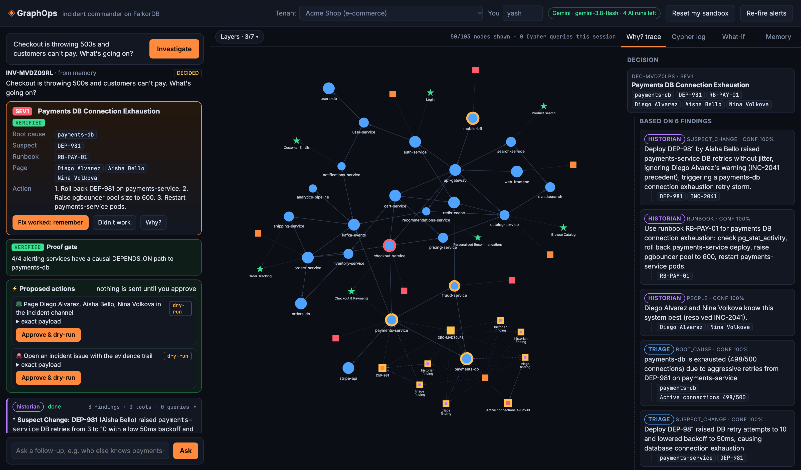
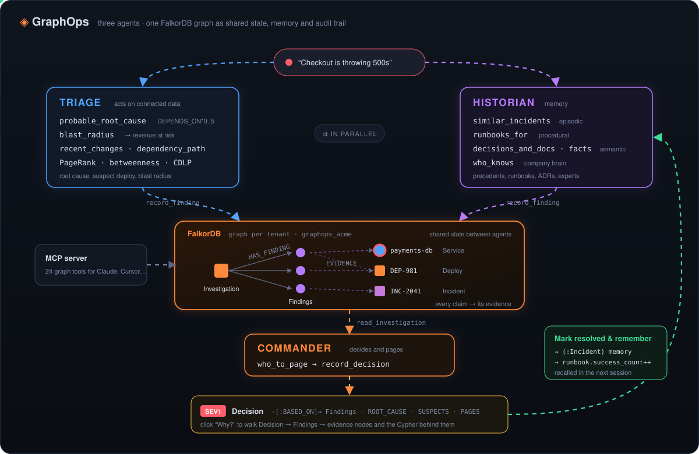

# ◈ GraphOps: a multi-agent incident commander on FalkorDB

> "Checkout is throwing 500s and customers can't pay." In seconds GraphOps says it's **payments-db**
> connection exhaustion triggered by **DEP-981** (a retry change shipped 23 minutes ago). This is the same failure as **INC-2041**,
> so it recommends rolling back and following **RB-PAY-01**, and it pages **Diego** (on call), **Nina** (who fixed it last time) and
> **Aisha** (who wrote the deploy). Every claim links back to the graph nodes and Cypher queries behind it.

Built for **Graph Hacks: Context for AI Agents** (WeMakeDevs × FalkorDB). It targets all three tracks.



*Left: agent timeline and the Commander's decision. Center: the FalkorDB graph, with the decision's evidence subgraph highlighted. Right: the Why? trace from Decision to Findings to evidence nodes.*

## Submission at a glance

| | |
| --- | --- |
| **Tracks entered** | **Track 1: Agents That Act on Connected Data** (primary), Track 2: Agent Memory and Coordination, Track 3: Company Brain |
| **FalkorDB's role** | The agents' only context layer. Every tool is a Cypher query or FalkorDB algorithm, and agent findings, decisions, conversation turns and learned incidents are written back into the graph. Without FalkorDB there is nothing for the agents to reason over, share or remember. |
| **Data** | 100% synthetic: fictional companies (Acme Shop, Globex Stream), people, services and incidents written for this project. No private or restricted data. |
| **Run it** | `docker compose up --build`, or see [Run it](#run-it) |
| **AI assistance** | Built with an AI coding assistant. See [AI assistance disclosure](#ai-assistance-disclosure) |

## Why a graph

An incident is a question about how things connect. Which upstream services alert *because of* a broken dependency?
What changed *next to* the failing node? Who has fixed *this* system before? What did we *decide* after the last outage?
Each of these is a multi-hop traversal. GraphOps gives its agents those traversals as tools. The agents also
**write their reasoning back into the same graph**, so the graph serves as their shared state, their long-term memory and their audit trail.

## What it does

<p align="center"></p>

<details><summary>Text version of the diagram</summary>

```
            ┌────────────── orchestrator ──────────────┐
            │                                          │
   ┌────────▼────────┐  (parallel)  ┌─────────────────▼┐
   │  TRIAGE agent   │              │  HISTORIAN agent │
   │ root cause, blast│             │ episodic/semantic│
   │ radius, deploys, │             │ /procedural      │
   │ PageRank, BC     │             │ memory, ADRs     │
   └────────┬────────┘              └─────────┬────────┘
            │ record_finding                  │ record_finding
            ▼                                 ▼
      ┌──────────────── FalkorDB tenant graph ────────────────┐
      │ (:Investigation)-[:HAS_FINDING]->(:Finding)-[:EVIDENCE]->(any node)
      └───────────────────────────┬───────────────────────────┘
                                  │ read_investigation
                        ┌─────────▼─────────┐
                        │ COMMANDER agent   │  who_to_page → record_decision
                        └─────────┬─────────┘
                                  ▼
   (:Decision)-[:BASED_ON]->(:Finding)  -[:ROOT_CAUSE]->(:Service)  -[:SUSPECTS]->(:Deploy)
              -[:USES]->(:Runbook)       -[:PAGES]->(:Person)
                                  │  "Mark resolved & remember"
                                  ▼
   (:Incident {source:'graphops'})  ← episodic memory the Historian finds next session
   Runbook.success_count += 1       ← procedural memory gets stronger
```

</details>

* **Triage** (Track 1) calls `probable_root_cause`. It walks `DEPENDS_ON*0..5` from every alerting service and scores the
  nodes that explain the most alerts, boosting the deepest alerting node and nodes next to a recent deploy. It then calls
  `recent_changes`, `blast_radius` (upstream services, business capabilities and **revenue at risk per minute**) and
  `dependency_path` (`shortestPath`) to show how the failure propagates. `critical_nodes` runs **PageRank** and
  **betweenness centrality**, and `service_clusters` runs **label propagation**.
* **Historian** (Track 2) runs *at the same time* as Triage and writes to the same investigation. It recalls
  **episodic** memory (`similar_incidents`, including incidents GraphOps itself learned), **procedural** memory (`runbooks_for`,
  ranked by graph distance and how often each runbook worked) and **semantic** memory (`decisions_and_docs`, which covers ADRs,
  documents and `Fact` nodes taught by users).
* **Commander** (Track 3) never receives the other agents' output directly. It **reads the shared investigation subgraph**,
  ranks who to page (on-call + past resolvers + deploy authors + people who worked on the system, each with reasons)
  and records a `Decision` linked to every finding, which in turn links to its evidence nodes.
* **Chat** answers follow-ups with every tool plus guarded read-only text-to-Cypher. It loads the conversation
  history *from the graph* (`(:Investigation)-[:HAS_TURN]->(:Turn)-[:NEXT]->(:Turn)`), and `remember_fact` lets it learn from users.

### Mapping to the tracks

| Track | What GraphOps does |
| --- | --- |
| **1 · Act on connected data** | Multi-hop root-cause scoring, blast radius with revenue impact, shortest-path propagation, PageRank, betweenness and CDLP as agent tools, an **MCP server** exposing all 19 tools, and decisions you can explain from evidence |
| **2 · Memory & coordination** | Episodic (Incidents), semantic (Facts/ADRs) and procedural (Runbook success counts) memory. Persistent conversation turns, per-user history (`(:User)-[:STARTED]->(:Investigation)`), parallel agents sharing state only through the graph with concurrent writes, and **one isolated graph per tenant** (`graphops_acme`, `graphops_globex`) |
| **3 · Company brain** | People, teams, services, capabilities, deploys, docs, ADRs and incidents in one graph. Who owns what, who knows what (`who_knows`), decisions traced to their motivating incident (`ADR-022 -[:MOTIVATED_BY]-> INC-2041`), and answers with sources |

### Explainability you can click

* Each agent step in the timeline shows the tool, its arguments, its result and the **exact Cypher with parameters**.
* The **Why? trace** tab renders `Decision → BASED_ON → Finding → EVIDENCE → node` and highlights that subgraph on the canvas.
* The **Cypher log** tab lists every query the agents ran, with row counts and timings.
* The live graph pulses each node in the acting agent's colour as tools touch it.

## Run it

**Fastest (Docker):**

```bash
GEMINI_API_KEY=your-key docker compose up --build
# open http://localhost:3000 (the graph seeds itself on first load)
```

**Local Node + any FalkorDB:**

```bash
cd graphops
npm install
cp .env.example .env      # add GEMINI_API_KEY and FalkorDB connection
npm run seed              # seeds tenants acme + globex
npm start                 # http://localhost:3000
```

FalkorDB options:
* **Docker:** `docker run -p 6379:6379 -p 3001:3000 falkordb/falkordb:latest` (or use `docker compose` above)
* **FalkorDB Cloud:** set `FALKORDB_HOST`, `FALKORDB_PORT`, `FALKORDB_USERNAME`, `FALKORDB_PASSWORD` (and `FALKORDB_TLS=true` if your instance uses TLS).

**No LLM key or rate-limited?** Set `GRAPHOPS_SCRIPTED=true`, or let it fall back by itself. Each agent then runs a deterministic
playbook over the *same* graph tools and writes the *same* findings and decisions, so it keeps working. With Gemini,
the agents choose their own tools. On a 429 they back off and step down from `gemini-3.8-flash` to `gemini-3.5-flash-lite`.

### Use the graph tools from Claude, Cursor or any MCP client

```json
{
  "mcpServers": {
    "graphops": {
      "command": "node",
      "args": ["/absolute/path/to/graphops/src/mcp.js", "acme"],
      "env": { "FALKORDB_HOST": "localhost", "FALKORDB_PORT": "6379" }
    }
  }
}
```


## Graph model

```
(:Service {name, kind, tier, status})-[:DEPENDS_ON]->(:Service)
(:Service)-[:OWNED_BY]->(:Team)<-[:MEMBER_OF|ON_CALL_FOR]-(:Person)
(:Service)-[:POWERS]->(:Capability {revenue_per_min})
(:Deploy)-[:CHANGED]->(:Service), (:Deploy)-[:AUTHORED_BY]->(:Person)
(:Alert)-[:FIRED_ON]->(:Service)
(:Incident)-[:ROOT_CAUSE|AFFECTED]->(:Service), -[:RESOLVED_BY]->(:Person), -[:MITIGATED_WITH]->(:Runbook), -[:TRIGGERED_BY]->(:Deploy)
(:Runbook {success_count})-[:FOR]->(:Service)
(:Decision)-[:ABOUT]->(:Service), -[:MADE_BY]->(:Person), -[:MOTIVATED_BY]->(:Incident)
(:Document)-[:DOCUMENTS]->(:Service), (:Fact)-[:ABOUT]->(:Service), (:Person)-[:WORKED_ON]->(:Service)
-- agent state & memory --
(:User)-[:STARTED]->(:Investigation)-[:HAS_FINDING]->(:Finding {agent, kind, confidence})-[:EVIDENCE]->(*)
(:Investigation)-[:CONCLUDED]->(:Decision {source:'agent'})-[:BASED_ON]->(:Finding)
(:Investigation)-[:HAS_TURN]->(:Turn)-[:NEXT]->(:Turn)
(:Incident {source:'graphops'})-[:FROM_INVESTIGATION]->(:Investigation)
```

## Cypher queries and algorithms the product depends on

All of these live in [`src/tools.js`](src/tools.js). Each agent tool is one of them.

**1. Root-cause ranking** (`probable_root_cause`). Multi-hop from every alerting service. The candidate that explains the most alerts, alerts itself, sits deepest and is next to a recent deploy wins.
```cypher
MATCH (al:Alert {status: 'firing'})-[:FIRED_ON]->(a:Service)
WITH collect(DISTINCT a) AS alerting
UNWIND alerting AS a
MATCH p = (a)-[:DEPENDS_ON*0..5]->(c:Service)
WITH c, alerting, collect(DISTINCT a.name) AS explains, max(length(p)) AS depth
OPTIONAL MATCH (c)<-[:FIRED_ON]-(own:Alert {status: 'firing'})
WITH c, alerting, explains, depth, count(own) AS own_alerts
OPTIONAL MATCH (c)-[:DEPENDS_ON]->(down:Service)<-[:FIRED_ON]-(:Alert {status: 'firing'})
WITH c, alerting, explains, depth, own_alerts, count(DISTINCT down) AS alerting_deps
OPTIONAL MATCH (d:Deploy)-[:CHANGED]->(x:Service)
WHERE d.at > $since AND (x = c OR (x)-[:DEPENDS_ON]->(c))
RETURN c.name AS candidate, explains, depth, own_alerts, alerting_deps,
       collect(DISTINCT {deploy: d.id, service: x.name}) AS nearby_deploys
```

**2. Blast radius and revenue at risk** (`blast_radius`). Reverse traversal to everything upstream and the business capabilities it powers.
```cypher
MATCH p = (up:Service)-[:DEPENDS_ON*1..4]->(s:Service {name: $service})
WITH up, min(length(p)) AS hops
MATCH (up)-[:OWNED_BY]->(team:Team)
RETURN up.name, up.tier, hops, team.name ORDER BY hops;

MATCH (s:Service {name: $service})<-[:DEPENDS_ON*0..4]-(x:Service)-[:POWERS]->(c:Capability)
RETURN c.name, c.revenue_per_min, collect(DISTINCT x.name) AS via
```

**3. Failure propagation path** (`dependency_path`). FalkorDB `shortestPath`.
```cypher
MATCH (a:Service {name: $from}), (b:Service {name: $to})
WITH a, b
RETURN [n IN nodes(shortestPath((a)-[:DEPENDS_ON*1..10]->(b))) | n.name] AS path
```

**4. Graph algorithms as agent tools** (`critical_nodes`, `service_clusters`).
```cypher
CALL algo.pageRank('Service', 'DEPENDS_ON') YIELD node, score RETURN node.name, score ORDER BY score DESC LIMIT 8;
CALL algo.betweenness({nodeLabels: ['Service'], relationshipTypes: ['DEPENDS_ON'], samplingSize: 64, samplingSeed: 7})
  YIELD node, score RETURN node.name, score ORDER BY score DESC LIMIT 8;
CALL algo.labelPropagation({nodeLabels: ['Service'], relationshipTypes: ['DEPENDS_ON']})
  YIELD node, communityId RETURN communityId, collect(node.name) AS services
```

**5. Episodic memory recall** (`similar_incidents`). Past incidents ranked by service overlap, with a bonus when the root cause matches.
```cypher
MATCH (i:Incident)-[:AFFECTED|ROOT_CAUSE]->(s:Service) WHERE s.name IN $services
WITH i, collect(DISTINCT s.name) AS overlap
MATCH (i)-[:ROOT_CAUSE]->(root:Service)
OPTIONAL MATCH (i)-[:RESOLVED_BY]->(p:Person)
OPTIONAL MATCH (i)-[:MITIGATED_WITH]->(rb:Runbook)
RETURN i.id, i.title, root.name, overlap, p.name AS resolved_by, rb.id AS runbook,
       size(overlap) + CASE WHEN root.name IN $services THEN 2 ELSE 0 END AS similarity
ORDER BY similarity DESC
```

**6. Procedural memory** (`runbooks_for`). Runbooks ranked by graph distance, then by how often they worked.
```cypher
MATCH p = (s:Service {name: $service})-[:DEPENDS_ON*0..2]-(x:Service)<-[:FOR]-(rb:Runbook)
WITH rb, x, min(length(p)) AS distance
RETURN rb.id, rb.title, x.name, distance, rb.success_count ORDER BY distance, rb.success_count DESC
```

**7. Who to page** (`who_to_page`). Combines four relationship types into a ranked list with reasons. See `src/tools.js`.
On-call `(:Person)-[:ON_CALL_FOR]->(:Team)<-[:OWNED_BY]-(s)`, past resolvers `(s)<-[:ROOT_CAUSE|AFFECTED]-(:Incident)-[:RESOLVED_BY]->(:Person)`,
recent deploy authors `(s)-[:DEPENDS_ON*0..1]-(:Service)<-[:CHANGED]-(:Deploy)-[:AUTHORED_BY]->(:Person)` and `(:Person)-[:WORKED_ON]->(s)`.

**8. Shared state and the decision trace** (`record_finding`, `record_decision`, `decisionTrace`).
```cypher
// a finding linked to its evidence nodes
MATCH (inv:Investigation {id: $inv})
CREATE (inv)-[:HAS_FINDING]->(f:Finding {agent: $agent, kind: $kind, summary: $summary, confidence: $confidence})
WITH f
OPTIONAL MATCH (n) WHERE n.name IN $evidence OR n.id IN $evidence
FOREACH (_ IN CASE WHEN n IS NULL THEN [] ELSE [1] END | CREATE (f)-[:EVIDENCE]->(n));

// "why?": decision -> findings -> evidence
MATCH (:Investigation {id: $id})-[:CONCLUDED]->(d:Decision)-[:BASED_ON]->(f:Finding)-[:EVIDENCE]->(e)
RETURN d, f, e
```

**9. Learning from a resolved incident** (`resolveInvestigation` in [`src/memory.js`](src/memory.js)). The decision becomes an `Incident` with
`ROOT_CAUSE`, `AFFECTED`, `RESOLVED_BY`, `MITIGATED_WITH` and `TRIGGERED_BY` edges, and `SET rb.success_count = rb.success_count + 1`.

## Code map

| File | Purpose |
| --- | --- |
| `src/tools.js` | 19 graph tools (Cypher + FalkorDB algorithms) shared by the agents, the HTTP API and MCP |
| `src/agents.js` | Gemini function-calling loop, triage/historian/commander/chat agents, parallel orchestration, scripted fallback |
| `src/memory.js` | Investigations, turns, per-user history, decision trace, and resolve → episodic memory |
| `src/seed.js` | Multi-tenant seed data (Acme e-commerce, Globex streaming) |
| `src/db.js` | FalkorDB connection, per-tenant graphs, Cypher tracing via AsyncLocalStorage |
| `src/server.js` | Express API and NDJSON event streaming |
| `src/mcp.js` | MCP stdio server |
| `public/` | Ops console UI (vis-network). `?tenant=acme&inv=INV-…` deep-links to an investigation from memory |
| `Dockerfile`, `docker-compose.yml` | One-command FalkorDB + GraphOps |

## AI assistance disclosure

As the rules require: this project was built with the help of **Claude Code** (Anthropic), an AI coding assistant.
It generated much of the code, the seed data and the docs under my direction. I chose the problem and the tracks,
and set up FalkorDB Cloud and the Gemini API. The system was tested end to end against a live FalkorDB Cloud instance,
and issues found in testing were fixed along the way (model fallback, root-cause grounding, pagee matching).
At runtime, the agents themselves use Google Gemini through function calling.

## License

MIT
